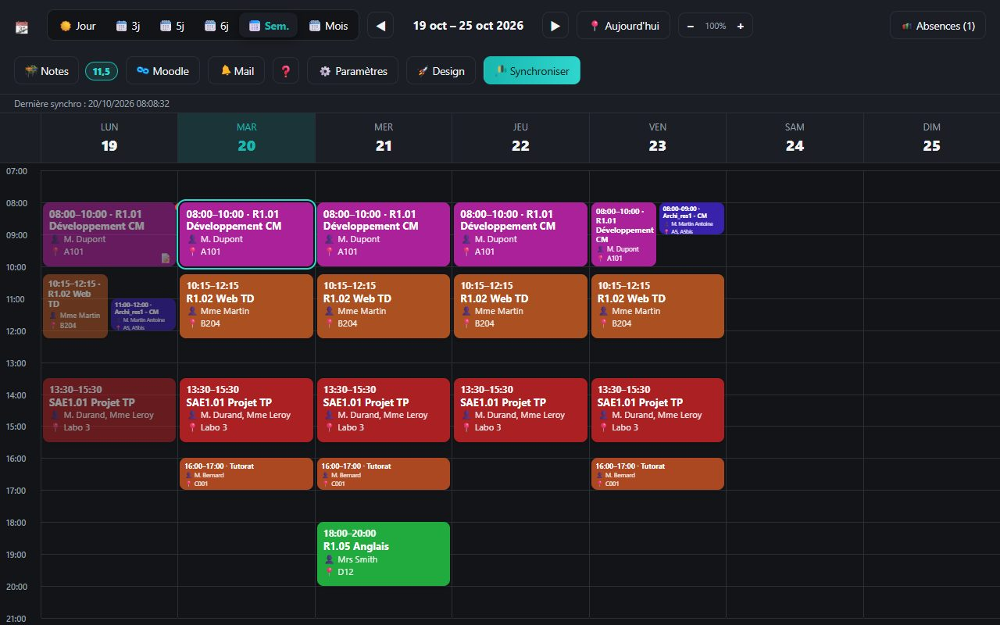
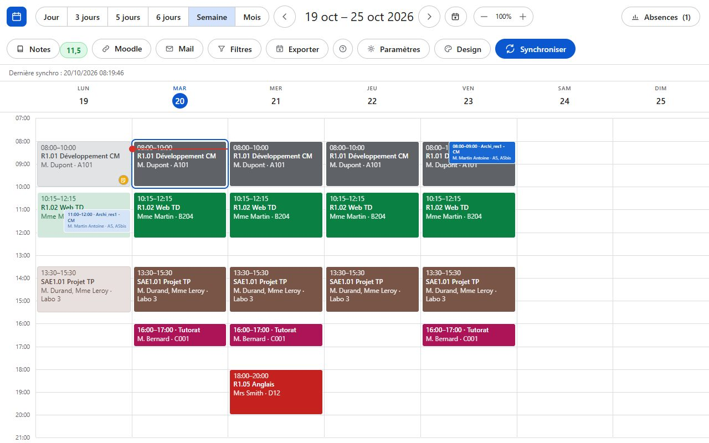
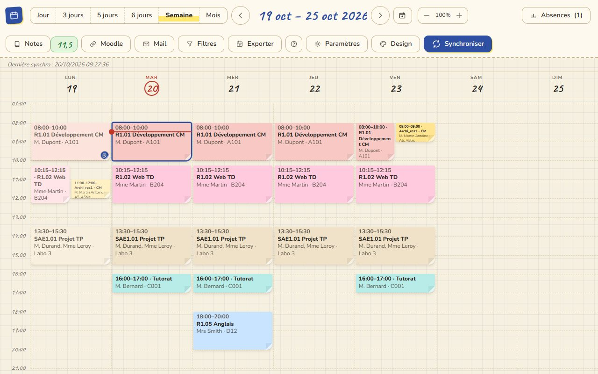
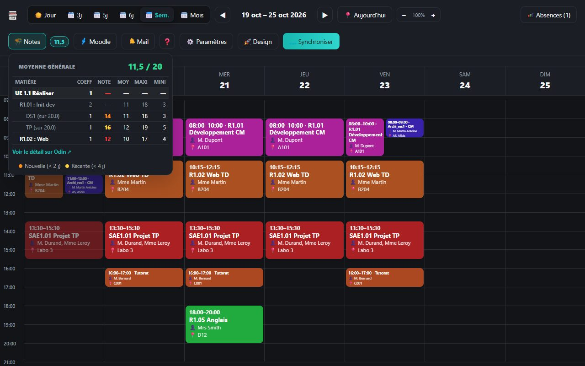
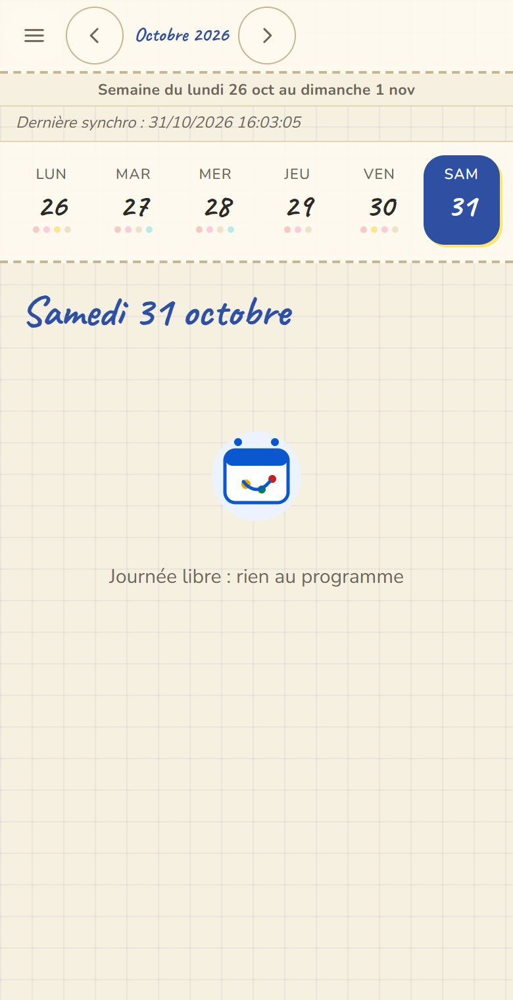
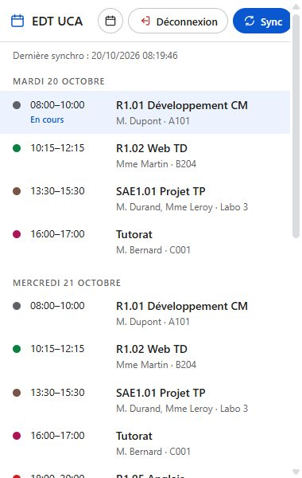

# Emploi du temps UCA — extension Chrome (non officielle)

Extension Chrome/Edge (Manifest V3) qui récupère ton emploi du temps, tes absences et ton relevé de notes depuis Odin (IUT Clermont Auvergne) avec **ta propre session**, et les affiche dans un agenda dans la barre d'outils.

Non officielle, non affiliée à l'Université Clermont Auvergne. Aucune donnée n'est envoyée à un serveur tiers : tout reste stocké localement dans ton navigateur (`chrome.storage.local`).

Faite pour rendre l'emploi du temps plus simple à lire au quotidien, avec un affichage qui s'adapte à chaque étudiant : trois designs au choix, vue jour/semaine/mois, filtres, rappels, et tout ce qui est listé ci-dessous.

## Captures d'écran

| Animé | Professionnel | Carnet |
|---|---|---|
|  |  |  |

| Relevé de notes | Vue mobile | Popup |
|---|---|---|
|  |  |  |

D'autres captures de chaque design (vue mois, détail d'un cours...) sont dans `designs/<id>/previews/` et défilent dans le sélecteur de design de l'extension.

## Fonctionnalités

- **Synchronisation** : connexion CAS (fenêtre dédiée, 15 min pour valider la double authentification) puis reconnexion silencieuse tant que la session Odin reste valide. Détection automatique de session expirée.
- **Emploi du temps** : vues Jour / 3 jours / 5 jours / 6 jours / Semaine / Mois, zoom réglable, grille horaire (la journée la plus longue tient à l'écran sans scroll à 100 %).
- **Absences** : déclarées, justifiées, non justifiées, avec motif présenté, journées non justifiées, et la liste de tes déclarations (période, motif, statut) — synchronisées en même temps que l'emploi du temps.
- **Relevé de notes** : tableau UE → matière → évaluation (Coeff / Note / Moy / Maxi / Mini), copié depuis Odin, avec **moyenne générale** pondérée par les coefficients. Les notes apparues depuis moins de 2 jours sont en orange, depuis moins de 4 jours en jaune (Odin ne datant pas les notes, l'extension retient le moment où elle voit chaque note pour la première fois).
- **Notes personnelles** : un champ texte par cours, signalé par un petit indicateur sur le cours.
- **Déconnexion** depuis le popup, avec la durée de validité restante de la session.
- **Liens rapides** Moodle et messagerie Zimbra.
- **Mise à jour** : vérification de la version sur GitHub (voir [`UPDATES.md`](UPDATES.md)).
- **Page d'aide intégrée** (`aide.html`, bouton ❓) qui explique chaque fonctionnalité.
- **Rappel avant chaque cours** (notification avec matière et salle, délai réglable).
- **Synchronisation automatique** en arrière-plan (toutes les 1 à 12 h) : uniquement la reconnexion silencieuse, aucune fenêtre ne s'ouvre ; si la session a expiré, l'icône affiche « ! ».
- **Changements d'emploi du temps** détectés à chaque synchro (cours ajouté, annulé, déplacé, changement de salle) : badge sur le cours pendant 7 jours, cours annulé affiché barré, notification.
- **Notification de nouvelle note**.
- **Filtres** : recherche (matière, prof, salle), type de cours (CM / TD / TP / Examen), matières masquées ; appliqués à toutes les vues et au popup.
- **Export .ics** (Google Agenda, Outlook, téléphone) : semaine affichée, 4 semaines ou tout, avec rappels intégrés.
- **Pastille sur l'icône** : « 25m » avant un cours proche, sinon l'heure du prochain cours du jour, ou le nombre de cours restants.
- **Paramètres** communs à tous les designs (`settings.html`) : vue à l'ouverture, masquer le week-end, rappels, synchro auto, pastille, alertes.
- Responsive (menu hamburger sous 820px).
- **Trois designs au choix** : animé (sombre turquoise), professionnel (clair épuré), carnet (papier crème, écriture manuscrite, post-it).
- **Plusieurs designs au choix** : au premier lancement l'extension demande quel design utiliser (changeable ensuite). Les fonctionnalités sont identiques, seul l'affichage change.

## App téléphone (Android et iPhone)

Une app installable (PWA) est servie par GitHub Pages : <https://kiricoucou.github.io/uca-extension/app/>.

- **Installation** : ouvre le lien sur ton téléphone. Android : bouton « Installer l'application ». iPhone (Safari) : Partager → « Sur l'écran d'accueil ». Icône, écran de démarrage et plein écran comme une vraie app ; fonctionne hors ligne.
- **Données** : une app web ne peut pas se connecter à Odin elle-même (le navigateur interdit de lire un autre site avec ta session, et la double authentification passe par le CAS). Les données viennent donc de l'extension, trois façons au choix dans **Exporter** (sur l'ordinateur) :
  - **Copier un lien** — colle-le dans un SMS, un mail ou n'importe quelle appli, et ouvre-le sur ton téléphone : import automatique, sans caméra. Les données voyagent dans le lien lui-même (après le `#`), jamais envoyées à un serveur.
  - **QR code animé** — pratique à la première installation : dans l'app, **Importer → Scanner**.
  - **Fichier `.ucasync`** en secours (Drive, AirDrop, ou « Partager → EDT UCA » sur Android).
- Les trois designs, les filtres, les notes, les absences et l'export `.ics` fonctionnent dans l'app. Les rappels passent par l'export `.ics` (avec alarmes) importé dans le calendrier du téléphone.
- Refais un transfert après chaque synchro sur l'ordinateur pour mettre l'app à jour.

## Tutoriel d'installation

Pas de Chrome Web Store (extension non publiée) : l'installation se fait « en mode développeur », en quelques clics.

### Chrome / Edge

1. **Télécharge le dépôt** : bouton vert **Code** sur cette page → **Download ZIP**, puis décompresse le dossier obtenu (ou clone-le avec `git clone` si tu connais git).
2. Ouvre un nouvel onglet et tape `chrome://extensions` dans la barre d'adresse (sur Edge : `edge://extensions`).
3. En haut à droite, active **Mode développeur**.
4. Clique **Charger l'extension non empaquetée**, puis sélectionne le dossier décompressé (celui qui contient `manifest.json`).
5. L'icône de l'extension apparaît dans la barre d'outils (épingle-la pour la garder visible). Un onglet s'ouvre automatiquement pour **choisir un design** (animé, professionnel ou carnet) — rien n'empêche d'en changer plus tard avec le bouton **Design**.
6. Clique l'icône de l'extension → **Se connecter**. Une fenêtre CAS UCA s'ouvre : connecte-toi normalement (identifiant, mot de passe, double authentification). L'emploi du temps se charge automatiquement une fois connecté.

### Firefox

Même principe, avec `manifest.firefox.json` : renomme-le en `manifest.json` (en remplaçant celui déjà présent) **avant** de charger le dossier, puis `about:debugging` → **Ce Firefox** → **Charger un module complémentaire temporaire** → sélectionne n'importe quel fichier du dossier (`manifest.json` par exemple).

Avec Firefox, le module est retiré à chaque fermeture du navigateur (limite des extensions temporaires) : il faut refaire le chargement à chaque redémarrage, ou passer par Firefox Android une fois l'extension publiée sur addons.mozilla.org (pas encore fait).

### Sur ton téléphone

Pas besoin d'installer l'extension : voir la section [App téléphone](#app-téléphone-android-et-iphone) ci-dessus, qui fonctionne comme une vraie app une fois les données transférées depuis l'extension.

## Structure

Une seule extension (la racine du dépôt). La logique est commune ; chaque dossier de `designs/` ne contient que l'affichage.

| Fichier | Rôle |
|---|---|
| `manifest.json` | Manifest unique (popup par défaut : `choose.html`) |
| `background.js` | Service worker : connexion CAS, scraping, synchro, déconnexion, mise à jour GitHub, application du design choisi (`chrome.action.setPopup` / `setIcon`) |
| `choose.html` / `choose.js` | Sélecteur de design (premier lancement, puis bouton « Design ») |
| `settings.html` / `settings.js`, `core/settings.js` | Page Paramètres et valeurs par défaut des réglages (partagées avec le service worker) |
| `core/shared.js` | API de design (`UCA_defineDesign`) + briques communes (mise à jour, changement de design) |
| `core/tools.js` | Filtres et export .ics |
| `core/popup.js` / `core/agenda.js` | Logique du popup et de l'agenda, identique pour tous les designs |
| `designs/designs.json` | Registre des designs disponibles |
| `designs/<id>/` | Un design : `popup.html`, `agenda.html`, `aide.html`, `confidentialite.html`, `design.js`, `icons/`, assets |
| `core/env.js` | Dans l'app téléphone, remplace les API de l'extension (stockage, messages) ; ne fait rien dans l'extension |
| `core/transfer.js` | Transfert vers l'app (QR animé, fichier `.ucasync`) |
| `app/`, `app.webmanifest`, `sw.js` | App téléphone : accueil, import, guide d'installation, icônes, écrans de démarrage, hors ligne |
| `vendor/` | Générateur et lecteur de QR codes (licences dans `vendor/README.md`) |
| `content-bridge.js` | Relais de messages vers le site web (localhost/file) |

### Ajouter un design

1. Copier un dossier existant de `designs/` sous un nouveau nom et modifier ses HTML/CSS/assets (garder les `id` des éléments utilisés par le core).
2. Adapter son `design.js` : `UCA_defineDesign({...})` ne définit que ce qui change (icônes, textes, couleurs des cours, variantes d'affichage) ; tout le reste prend les valeurs par défaut de `core/shared.js`.
3. Ajouter une entrée dans `designs/designs.json` (`id`, `name`, `description`, `folder`, `preview`, `screenshots`). Les captures (`previews/` du dossier du design) défilent dans le sélecteur.

Le sélecteur et le service worker lisent le registre : aucun autre fichier à toucher.

## Tests

Prérequis : Python 3 + Playwright (`pip install playwright` puis `playwright install chromium`).

| Commande | Rôle |
|---|---|
| `python -I -X utf8 tests/check_design.py` | Chaque design du registre fournit tous les éléments utilisés par le core et ses captures |
| `python -I -X utf8 tests/e2e.py [dossier]` | Charge l'extension dans Chromium avec des données factices et vérifie chaque design : pas de scroll, aucun bloc coupé, barre sur 2 étages dans le même ordre, moyenne, notes récentes, réglages, vue téléphone, 0 erreur JS (captures dans `dossier` si fourni) |
| `python -I -X utf8 tests/gen_icons.py <id>` | Rend `designs/<id>/icons/icon.svg` en PNG 16/32/48/128 |
| `python -I -X utf8 tests/pwa.py [dossier]` | Teste l'app téléphone servie en local (Android via Chromium, iPhone via WebKit) : installation, choix du design, import, hors ligne, raccourcis, aller-retour des QR codes |
| `python -I -X utf8 tests/gen_app_assets.py` | Régénère icônes et écrans de démarrage de l'app depuis `app/icons/icon.svg` |
| `python -I -X utf8 tests/gen_previews.py [id ...]` | Régénère les 6 captures du sélecteur (`designs/<id>/previews/`) |

## Confidentialité

Voir `confidentialite.html` dans le dossier de chaque design : l'extension utilise uniquement ta session existante sur `odin.iut.uca.fr` et `ent.uca.fr`, ne transmet rien à un tiers, tout reste local.

## Licence

Projet personnel, non affilié à l'UCA, fait pour rendre l'emploi du temps plus facile à lire au quotidien et pour s'adapter à chaque étudiant (choix du design, filtres, rappels...).

- **Partage** : je suis seul autorisé à partager, publier ou redistribuer ce code (dépôt, copie, build, lien de téléchargement...). Demande-moi avant de le publier ailleurs.
- **Modifications** : tu peux modifier ton exemplaire pour ton usage personnel, mais à tes propres risques — si une modification casse l'extension, affiche des données fausses, ou pose un problème quelconque, c'est de ta responsabilité, pas de la mienne.
- **Aucune garantie** : le projet est fourni tel quel, sans garantie de fonctionnement, de disponibilité ni d'exactitude des données affichées. L'UCA peut modifier Odin à tout moment et casser la récupération des données.

## Polices du design carnet

Caveat et Nunito, sous licence SIL Open Font License 1.1 (`designs/carnet/fonts/OFL-*.txt`), intégrées localement : aucune requête vers un service tiers.
